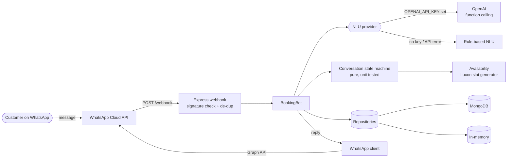

# WhatsApp Booking Bot

A WhatsApp chatbot backend that lets customers **book, view and cancel appointments by chatting**, with no app to install and no forms to fill in. It plugs into the official WhatsApp Cloud API, uses OpenAI to understand natural messages ("haircut tomorrow at 2pm"), and keeps the calendar consistent so two people can never get the same slot.

Built with Node.js, TypeScript, Express and MongoDB. It runs the same flow in production patterns I use in client work: WhatsApp Business integrations, OpenAI-powered assistants and scheduling engines.

> **Try it in 60 seconds, with no WhatsApp account, database or API key.** See [Quickstart](#quickstart).

---

## What the customer sees

```text
Customer: hi
Bot:      Hi! 👋 Welcome. I can help you with:
          1. Book an appointment
          2. See my bookings

Customer: book a haircut tomorrow at 10:30
Bot:      Please confirm:
          Haircut, Thu 26 Nov, 10:30
          Reply YES to book or NO to change.

Customer: yes
Bot:      You're booked ✅
          Haircut, Thu 26 Nov, 10:30
          Booking code: 32D847
          To cancel, send: cancel 32D847
```

Customers can also go step by step (service, then day, then time) by replying with numbers. Both paths end in the same confirmed booking.

<!-- Add screenshots of a real WhatsApp conversation here: docs/screenshot-booking.png -->

## What it does

- **Booking flow over WhatsApp**: greeting, pick a service, pick a day, pick a time, confirm.
- **Understands free text**: OpenAI function calling turns a message into a structured request (intent, service, date, time). Works in English and Arabic.
- **Never double-books**: availability is computed from existing bookings, and the database enforces it again at write time.
- **Timezone-correct**: working hours are defined in the business timezone (including daylight saving changes). Times are stored in UTC.
- **Self-service**: customers list their bookings and cancel with a short code. Nobody can cancel someone else's booking.
- **Runs without any external account**: no OpenAI key means a built-in rule-based understanding mode. No MongoDB means in-memory storage. No WhatsApp token means replies are logged. Good for demos, and the same code runs in production.

## Architecture



Design choices that matter:

| Choice                                                              | Why it helps                                                                                                                                       |
| ------------------------------------------------------------------- | -------------------------------------------------------------------------------------------------------------------------------------------------- |
| **State machine is a pure function** (`src/domain/stateMachine.ts`) | It returns the next state, a reply and an _action_ to perform. Easy to test, easy to reason about, no hidden side effects.                         |
| **AI only interprets, it never decides**                            | The model extracts intent and details. Business rules (availability, booking, cancelling) stay deterministic code, so the AI cannot invent a slot. |
| **Everything external is behind an interface**                      | `NluProvider`, `MessageSender`, `BookingRepository`. Swap OpenAI, WhatsApp or MongoDB without touching the booking logic.                          |
| **Graceful degradation**                                            | If OpenAI is down or returns invalid output, the bot falls back to rule-based understanding instead of failing the customer.                       |
| **Fast webhook response**                                           | The webhook answers `200` immediately and processes in the background, as WhatsApp requires. Retried deliveries are de-duplicated by message id.   |

## Tech stack

Node.js 20+, TypeScript (strict), Express 5, MongoDB with Mongoose, Luxon (time zones), Zod (config and AI output validation), Vitest and Supertest (tests), ESLint and Prettier, Docker.

## Quickstart

```bash
git clone https://github.com/elsaadymohamed2020/whatsapp-booking-bot.git && cd whatsapp-booking-bot
npm install
cp .env.example .env
npm test          # 20 tests
npm run chat      # talk to the bot in your terminal, no accounts needed
```

Want the HTTP server too? `npm run dev`, then in another terminal:

```bash
curl -s -X POST localhost:3000/dev/chat -H 'content-type: application/json' \
  -d '{"from":"201000000000","text":"book a consultation tomorrow at 10:00"}'
```

(`/dev/chat` only exists while `WHATSAPP_TOKEN` is empty.)

### With Docker (bot + MongoDB)

```bash
cp .env.example .env && docker compose up --build
```

### Connecting a real WhatsApp number

1. Create an app in [Meta for Developers](https://developers.facebook.com/) and add the WhatsApp product.
2. Put `WHATSAPP_TOKEN`, `WHATSAPP_PHONE_NUMBER_ID`, `WHATSAPP_VERIFY_TOKEN` and `WHATSAPP_APP_SECRET` in `.env`.
3. Expose the server over HTTPS (for local testing: `ngrok http 3000`).
4. In the Meta dashboard set the webhook URL to `https://<your-host>/webhook` with your verify token, and subscribe to the `messages` field.
5. Message your WhatsApp number.

## Configuration

| Variable                           | Default           | Description                                                            |
| ---------------------------------- | ----------------- | ---------------------------------------------------------------------- |
| `PORT`                             | `3000`            | HTTP port.                                                             |
| `MONGODB_URI`                      | empty             | MongoDB connection string. Empty means in-memory storage.              |
| `WHATSAPP_TOKEN`                   | empty             | Cloud API access token. Empty means dry-run (replies are logged only). |
| `WHATSAPP_PHONE_NUMBER_ID`         | empty             | The sending phone number id from Meta.                                 |
| `WHATSAPP_VERIFY_TOKEN`            | `change-me`       | Shared secret for the webhook verification handshake.                  |
| `WHATSAPP_APP_SECRET`              | empty             | Verifies the `X-Hub-Signature-256` header. Set this in production.     |
| `GRAPH_API_VERSION`                | `v21.0`           | Graph API version used for sending.                                    |
| `OPENAI_API_KEY`                   | empty             | Enables OpenAI understanding. Empty means rule-based mode.             |
| `OPENAI_MODEL`                     | `gpt-4o-mini`     | Model used for intent extraction.                                      |
| `BUSINESS_TIMEZONE`                | `Africa/Cairo`    | IANA timezone of the business.                                         |
| `BUSINESS_DAYS`                    | `1,2,3,4,5`       | Open weekdays (1 = Monday ... 7 = Sunday).                             |
| `BUSINESS_OPEN` / `BUSINESS_CLOSE` | `09:00` / `17:00` | Working hours, local time.                                             |
| `MIN_LEAD_MINUTES`                 | `60`              | Earliest bookable time from now.                                       |
| `BOOKING_HORIZON_DAYS`             | `14`              | How far ahead customers can book.                                      |

## Project layout

```text
src/
  server.ts              wiring: config, storage, WhatsApp, bot
  bot.ts                 one inbound message: session -> NLU -> state machine -> actions
  config.ts              validated environment config
  domain/
    stateMachine.ts      conversation flow (pure)
    slots.ts             timezone-aware availability (Luxon)
    catalog.ts           services (name, duration, price)
  ai/
    openai.ts            function-calling NLU with fallback
    rules.ts             rule-based NLU for demo mode
  whatsapp/
    client.ts            Graph API sender (+ dry-run and capture senders)
    webhook.ts           payload parsing and signature verification
  repositories/
    mongo.ts memory.ts   storage implementations behind one interface
  http/app.ts            routes: GET/POST /webhook, /health, /dev/chat
test/                    slots, state machine, webhook, end-to-end bot flow
```

## Tests and quality

```bash
npm test         # Vitest: slot generation (incl. DST), state machine, webhook, e2e booking flow
npm run lint     # ESLint
npm run build    # strict TypeScript
```

## What I'd add in production

This is a focused demo. For a real client deployment I would add:

- **Reminders**: automatic WhatsApp reminders 24h and 2h before, using approved message templates (needed outside the 24-hour window).
- **Owner dashboard**: manage services, staff, working hours and days off, and see the day's bookings.
- **Multiple staff and resources**: per-staff calendars instead of a single shared one.
- **Payments**: deposit or full payment with Stripe at confirmation time, with refunds on cancellation.
- **Rescheduling** in one message, plus cancellation rules (for example, no cancellation under 2 hours).
- **Persistent de-duplication and queues**: Redis for message-id de-duplication, and a job queue (BullMQ) so replies survive restarts.
- **Observability**: structured logs to a log service, error tracking (Sentry), and metrics.
- **Multi-language replies** and handing over to a human agent when the bot is unsure.
- **CI/CD**: GitHub Actions running lint, tests and Docker build on each push.

## About

Built by **Mohamed Elsaady**, backend engineer focused on API integrations (WhatsApp Business, Stripe, OpenAI) and scheduling systems. Available for freelance work: [GitHub](https://github.com/elsaadymohamed2020).

## License

MIT
